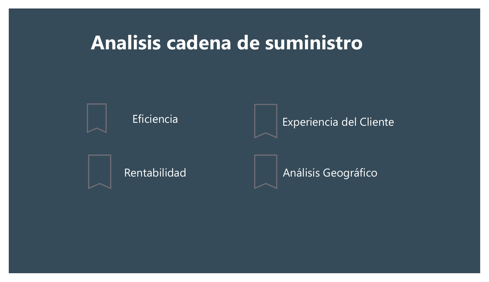
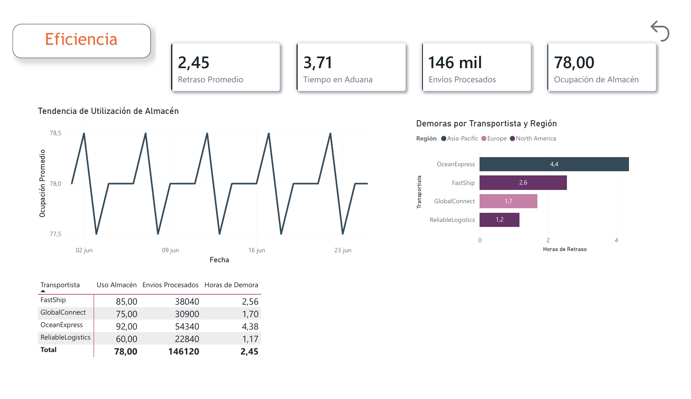
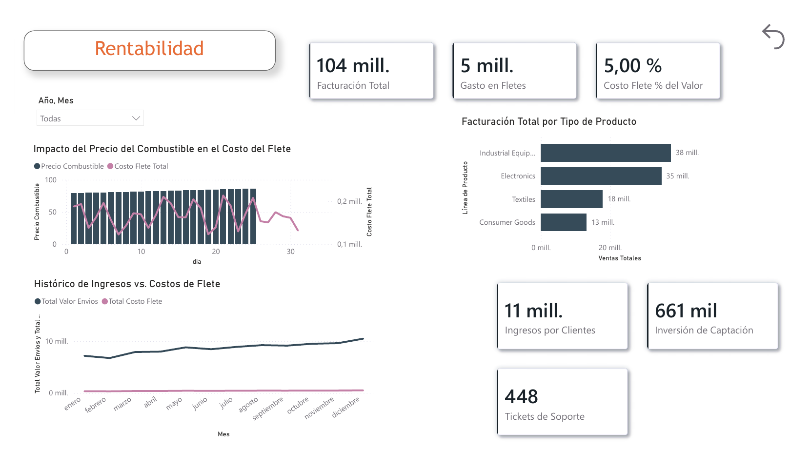
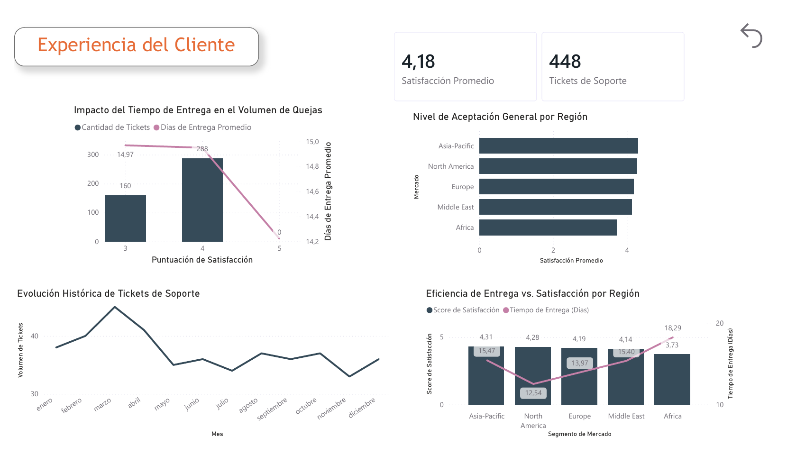
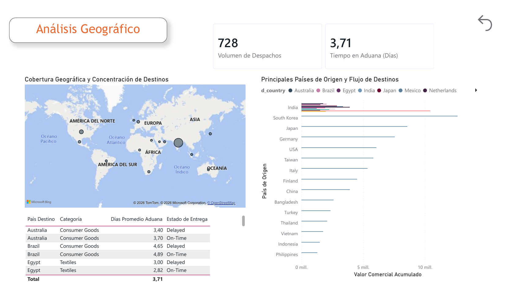
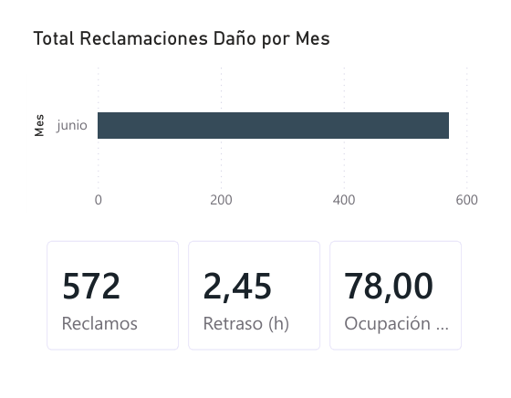

# Supply Chain Logistics

Análisis de una empresa ficticia de logística internacional con Python, SQL y Power BI.

**Herramientas:** Python (pandas, seaborn, matplotlib) · SQL (SQLite) · Power BI (DAX)



## Problema

Se quería ver el comportamiento de una empresa de logística y transporte, haciendo preguntas importantes para el negocio: qué causa los retrasos, cómo se comportan los costos, qué afecta la satisfacción del cliente y qué mejoras se podrían hacer. El análisis está pensado para dueños y gerentes.

Es un proyecto propio con el fin de afianzar lo aprendido en la especialización y en cursos de SQL, Python y Power BI.

## Datos

- **Fuente:** [Supply Chain Logistics Dataset](https://www.kaggle.com/datasets/anirudhbadampudi/supply-chain-logistics-dataset) (Kaggle, licencia CC0).
- **Tablas:** `customer` (750 filas), `shipment` (728 filas) y `logistics` (100 filas). El detalle de cada columna está en el [diccionario de datos](docs/data_dictionary.md).
- Las tablas no tienen llaves que las relacionen y manejan fechas distintas, por lo cual se analizaron por separado.

**Los datos son sintéticos.** Se notó ya que había fechas hasta 2029, el flete siempre era el 5 % del valor y el pago siempre a los 40 días. En la práctica el flete cambia según el peso, el tamaño y el destino. Sin embargo, no se puede controlar que los datos sean reales; lo que se controla es el proceso.

### Limpieza

En `shipment` había 24 filas corridas, todas de la ruta Mumbai → Singapore. Se detectó al cambiar el tipo de dato, ya que aparecían nulos. Los datos estaban, pero en la columna equivocada, así que se movió cada uno a su lugar:

```python
mask_corrida = (shipment['delivery_status'].isna()) & (shipment['customs_clearance_time_days'].apply(is_texto))
shipment.loc[mask_corrida, 'delivery_status'] = shipment.loc[mask_corrida, 'customs_clearance_time_days']
shipment.loc[mask_corrida, 'customs_clearance_time_days'] = shipment.loc[mask_corrida, 'freight_cost']
shipment.loc[mask_corrida, 'freight_cost'] = shipment.loc[mask_corrida, 'value']
```

No se encontraron duplicados.

## Enfoque

1. **Python:** preanálisis y limpieza ([`notebook/eda.ipynb`](notebook/eda.ipynb)).
2. **Power BI:** dashboard de 5 páginas con modelo estrella, tabla calendario, tabla de medidas y un tooltip que muestra el detalle de cada transportista sin cambiar de página. El `.pbix` y el PDF se pueden descargar en la [release v1.0](https://github.com/jeferssonvm/Supply-Chain-Logistics/releases/tag/v1.0).
3. **SQL:** preguntas de eficiencia, rentabilidad, cliente y geografía, con CTE y funciones de ventana ([`sql/`](sql/)).

Se utilizó SQLite ya que la base de datos queda en un solo archivo dentro del proyecto y no necesita un servidor.

## Resultados

### Eficiencia

- El 84 % de los envíos llega a tiempo. Es aceptable, con margen de mejora.
- Consumer Goods tiene el mayor porcentaje de retrasos. Sin embargo, al revisar las aduanas se encontró que no afectan, ya que todas las categorías manejan tiempos parecidos. Luego se analizaron las rutas y el retraso aumenta en la ruta India → UK, con 6 retrasos frente a 4 en las demás. Posiblemente hay algo en dicha ruta que está afectando los envíos.
- Electronics en export tiene el menor porcentaje de retrasos. Sin embargo, esto se debe principalmente a la ruta India → USA, que tiene el doble de envíos con la misma cantidad de retrasos que las demás rutas y uno de los menores tiempos de aduana. Sin dicha ruta, el porcentaje quedaría parecido al de las otras categorías.
- OceanExpress (Asia-Pacífico) tiene el mayor retraso y la mayor cantidad de reclamos por daño. Como es el único transportista de la región, no se puede saber si el problema es del transportista o de la ruta.
- Los reclamos por daño se disparan cuando el almacén pasa del 90 % de ocupación. Posiblemente, con el almacén más lleno es más difícil maniobrar y se le exige más al personal.
- FastShip se demora más que ReliableLogistics, a pesar de que operan en la misma región. Posiblemente se debe a que FastShip maneja casi el doble de envíos, lo cual mantiene su almacén más lleno en comparación con su contraparte, aumentando la demora.
- A mayor precio del combustible hay más retraso, menos de 2 horas de diferencia entre el precio bajo y el alto. Sin embargo, hay datos de menos de un mes, por lo cual puede ser correlación y no causalidad.

### Rentabilidad y geografía

- Todos los envíos pasan por India. Posiblemente es el centro de despacho de la empresa.
- India exporta barato e importa caro. Posiblemente exporta materia prima e importa productos ya fabricados.
- Las rutas con el flete más caro llegan todas a Mumbai. Como el flete es el 5 % del valor, no son rutas caras sino mercancía más cara.

### Clientes

- Entregar rápido no sube la calificación, pero cuando la entrega pasa de 18 días la satisfacción baja de golpe (de 4.21 a 3.13). Lo importante no es ser el primero, sino llegar a tiempo.
- Asia-Pacífico es el segmento que más compra y el más barato de conseguir. Sin embargo, es el que más retrasos tiene. A pesar de esto, mantiene la mejor satisfacción. Posiblemente el cliente entiende que la ruta es complicada, o no hay mucha variedad de empresas que ofrezcan el servicio de transporte. Cabe resaltar que es importante cuidar este segmento, ya que es el que más deja a la empresa.
- El costo de conseguir un cliente es casi igual en todas las regiones. Lo que cambia es cuánto compra cada cliente.
- África tiene la satisfacción más baja (3.73) y la mayor cantidad de tickets por cliente. Posiblemente se debe a que tiene tiempos de entrega altos, de 18 días en promedio.

## Recomendaciones

- Probar un segundo transportista en Asia y mantener el almacén entre 80 y 85 % de ocupación para evitar daños.
- Reducir los daños en el almacén, ya que dicho costo lo asume la empresa.
- Informar al cliente el tiempo de entrega por país tomando el máximo de días de aduana, en especial en Egipto y Brasil. Es preferible que el envío llegue antes a que llegue tarde.
- Mejorar primero la satisfacción en África, tanto para mantener a los clientes actuales como para mejorar la imagen frente a clientes nuevos. En Medio Oriente la satisfacción es normal, por lo cual se tendría que analizar más a fondo dicho mercado antes de decidir si se sigue invirtiendo en conseguir clientes.
- Clasificar los tickets de soporte según lo que más se repite, con el fin de ver qué se puede automatizar y cómo se resuelve cada tipo.

## Capturas

**Eficiencia:** retraso, ocupación del almacén y envíos por transportista.



**Rentabilidad:** facturación, gasto en fletes y su relación con el precio del combustible.



**Experiencia del cliente:** satisfacción, tickets de soporte y tiempo de entrega por región.



**Análisis geográfico:** flujos entre países, valor por país de origen y días de aduana por destino.



**Tooltip del transportista:** al pasar el mouse sobre un transportista se ven sus reclamos, retraso y ocupación.



## Límites

Los hallazgos describen el comportamiento del dataset. Sin embargo, no sirven para tomar decisiones reales, ya que los datos son sintéticos y las tablas no se relacionan.

Con datos reales se haría el mismo proceso desde cero, con una limpieza más detallada. Además, con datos de varios años se haría un análisis de tendencia (series de tiempo) para estimar cómo se comportarían los envíos y las ventas en el futuro.

## Cómo ejecutarlo

1. Descargar los 3 CSV de [Kaggle](https://www.kaggle.com/datasets/anirudhbadampudi/supply-chain-logistics-dataset) en `data/raw/`.
2. Ejecutar `notebook/eda.ipynb` (requiere pandas, numpy, matplotlib y seaborn). Guarda los datos limpios en `data/processed/`.
3. Ejecutar `python scripts/load_to_sqlite.py` para crear `data/supply_chain.db`.
4. Abrir las consultas de `sql/` con cualquier cliente de SQLite (se utilizó VS Code con SQLTools).
5. Abrir `pbix/analisis.pbix` con Power BI Desktop, o descargarlo de la [release v1.0](https://github.com/jeferssonvm/Supply-Chain-Logistics/releases/tag/v1.0).
